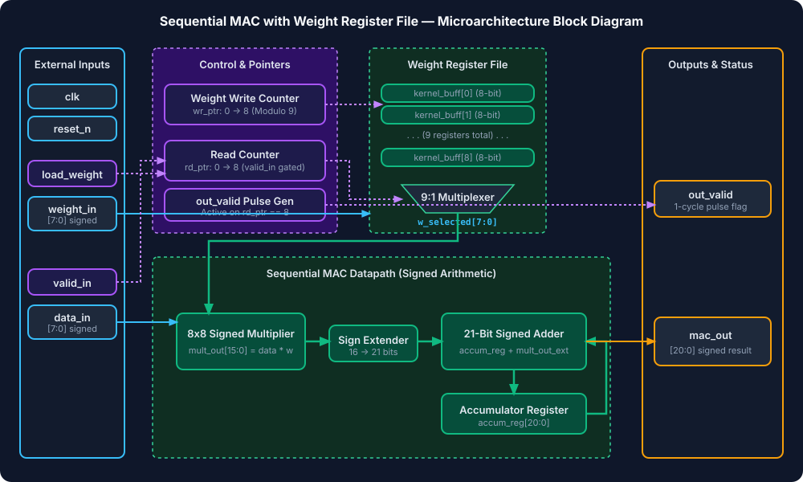
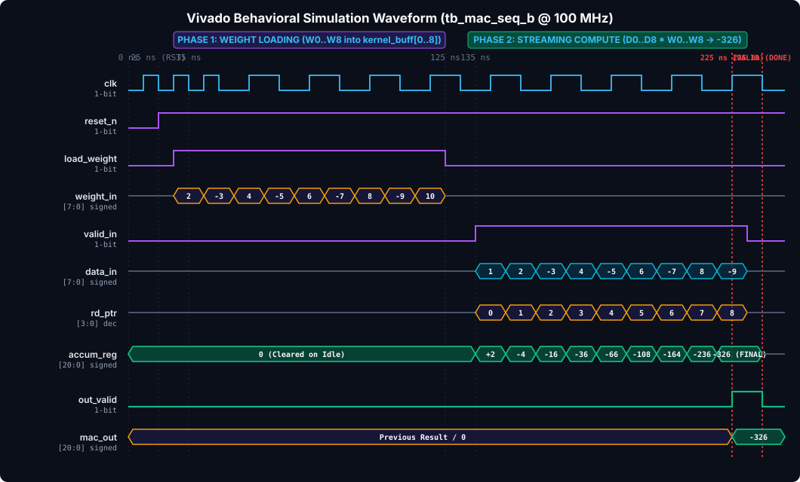

# Assignment 1(b): 8-Bit Sequential MAC with Local Register File

A synthesizable, hardware-efficient **8-Bit Sequential Multiply-Accumulate (MAC) Unit** designed in Verilog-2001 (`.v`) featuring an on-chip **Local Register File (`kernel_buff`)** to cache weight coefficients. Designed for low-power edge neural network inference and digital signal processing.

> [!TIP]
> **To view the rich visual diagrams & formatted document in VS Code:**
> Press <kbd>Ctrl</kbd> + <kbd>Shift</kbd> + <kbd>V</kbd> (or <kbd>Ctrl</kbd> + <kbd>K</kbd>, then <kbd>V</kbd> to open side-by-side preview).

---

## 📖 Table of Contents
1. [Architectural Overview & Specifications](#-architectural-overview--specifications)
2. [Microarchitecture & Block Diagram](#-microarchitecture--block-diagram)
3. [Two-Phase Execution Protocol](#-two-phase-execution-protocol)
4. [Mathematical Precision & Bit-Growth Proof](#-mathematical-precision--bit-growth-proof)
5. [Vivado Simulation Waveform Analysis](#-vivado-simulation-waveform-analysis)
6. [Source Files & Hierarchy](#-source-files--hierarchy)
7. [How to Run Vivado & CLI Simulations](#-how-to-run-vivado--cli-simulations)

---

## ⚙️ Architectural Overview & Specifications

| Parameter | Specification | Description / Rationale |
| :--- | :--- | :--- |
| **HDL Standard** | IEEE 1364-2001 (Verilog-2001) | Pure Verilog (`.v`), fully vendor neutral |
| **Vector Length ($N$)** | 9 Elements | Computes dot product of $3 \times 3$ kernel or length-9 vector |
| **Input Data Precision** | Signed 8-bit (`data_in[7:0]`) | Two's complement range: $-128 \text{ to } +127$ |
| **Input Weight Precision** | Signed 8-bit (`weight_in[7:0]`) | Two's complement range: $-128 \text{ to } +127$ |
| **Local Weight Buffer** | 9 $\times$ 8-bit Register File | Eliminates external memory bandwidth for weight reuse |
| **Datapath Multiplier** | Signed $8 \times 8 \rightarrow 16$-bit | Full dynamic range signed multiplier |
| **Accumulator Width** | 21-bit Signed (`accum_reg[20:0]`) | Zero-overflow accumulation across 9 cycles |
| **Output Port Width** | 21-bit Signed (`mac_out[20:0]`) | Registered output latched upon valid cycle |
| **Control Priority** | `reset_n` > `load_weight` > `valid_in` | Safe multi-phase operation prevents pipeline hazards |
| **Target FPGA** | AMD Artix-7 `xc7a35tcpg236-1` | Vivado 2026.1 synthesizable and verified |

---

## 🏛️ Microarchitecture & Block Diagram

The architecture separates the weight-programming phase from the streaming dot-product compute phase.



### Microarchitecture Details:
1. **Weight Register File (`kernel_buff[0:8]`)**: A 9-entry array of 8-bit registers sequentially filled via `wr_ptr` when `load_weight = 1`.
2. **Read Pointer (`rd_ptr`)**: Automatically addresses the corresponding weight `w_selected = kernel_buff[rd_ptr]` synchronously as data samples stream into `data_in`.
3. **Signed Multiplier & Sign Extender**: Computes 16-bit signed products and sign-extends them to 21 bits.
4. **21-Bit Accumulator**: Resets to zero upon the start of a new compute sequence and accumulates products for each cycle until `rd_ptr == 8`.
5. **Output Handshaking**: Pulses `out_valid` high for exactly one clock cycle when the 9th product completes and presents `mac_out`.

---

## 🔄 Two-Phase Execution Protocol

```
Time -------------------------------------------------------------------------------------------->
Phase 1: WEIGHT LOADING             Phase 2: STREAMING COMPUTATION
load_weight = 1                     load_weight = 0, valid_in = 1
weight_in = [W0, W1, ... W8]         data_in = [D0, D1, ... D8]
wr_ptr advances 0 -> 8              rd_ptr advances 0 -> 8
kernel_buff cached in fabric        accum_reg += D_i * W_i
                                    Cycle 9: out_valid = 1, mac_out = Final Sum
```

---

## 📐 Mathematical Precision & Bit-Growth Proof

1. **Individual Signed Product Range**:
   $$\min(P) = -128 \times +127 = -16,256$$
   $$\max(P) = -128 \times -128 = +16,384 \quad (\text{0x4000})$$
   Representing $+16,384$ in two's complement requires $15 + 1 = 16$ bits (range $[-32,768, +32,767]$).

2. **9-Sample Vector Sum Worst Case**:
   $$\max(\text{Sum}) = 9 \times (+16,384) = +147,456$$
   $$\min(\text{Sum}) = 9 \times (-16,256) = -146,304$$

3. **Bit-Width Requirement**:
   $$\text{Bits Required} = \lceil \log_2(147,456) \rceil + 1 = 18 + 1 = 19 \text{ bits}$$

4. **Hardware Allocation**:
   The hardware allocates **21 bits** (`signed [2*W+4:0]` for $W=8$):
   $$\text{Dynamic Capacity} = [-2^{20}, +2^{20}-1] = [-1,048,576, +1,048,575]$$
   Since $147,456 \ll 1,048,575$, **overflow is mathematically impossible**.

---

## 🔬 Vivado Simulation Waveform Analysis



### Verification Trace (`tb_mac_seq_b.v`):
- **Kernel Weights Loaded**: $\{2, -3, 4, -5, 6, -7, 8, -9, 10\}$
- **Data Vector 1 Streamed**: $\{1, 2, -3, 4, -5, 6, -7, 8, -9\}$
- **Execution**:
  $$\text{mac\_out} = (2 \cdot 1) + (-3 \cdot 2) + (4 \cdot -3) + (-5 \cdot 4) + (6 \cdot -5) + (-7 \cdot 6) + (8 \cdot -7) + (-9 \cdot 8) + (10 \cdot -9)$$
  $$\text{mac\_out} = 2 - 6 - 12 - 20 - 30 - 42 - 56 - 72 - 90 = -326$$
- **Result**: `out_valid` asserts at 225-235 ns with `mac_out = -326` with 0 mismatches.

---

## 📁 Source Files & Hierarchy

```
Assignment_1b_Sequential_MAC_RegFile/
├── mac_seq_b.v                 # Top-Level Synthesizable Sequential MAC RTL
├── tb_mac_seq_b.v              # Self-Checking Verification Testbench
├── Sequential_MAC_RegFile.xpr  # AMD Vivado 2026.1 Project File
├── Sequential_MAC_RegFile.wcfg # Vivado Waveform Configuration
├── run_sim.tcl                 # Vivado Batch Simulation Script
├── build_and_sim.tcl           # Automated Project Recreation Script
├── assets/
│   ├── block_diagram.svg       # Microarchitecture Architecture Diagram
│   └── simulation_waveform.svg # Vivado Simulation Waveform Diagram
├── README.md                   # Complete Architectural Documentation
└── .gitignore                  # Git Ignore Configuration
```

---

## 🚀 How to Run Vivado & CLI Simulations

### Option 1: AMD Vivado GUI
1. Open AMD Vivado 2026.1.
2. Select **Open Project** and browse to `Sequential_MAC_RegFile.xpr`.
3. In **Flow Navigator**, click **Run Simulation** -> **Run Behavioral Simulation**.
4. Open `Sequential_MAC_RegFile.wcfg` to view signals with pre-configured radixes and color grouping.

### Option 2: Vivado Batch Mode (CLI)
From PowerShell inside this directory:
```powershell
& "C:\AMDDesignTools\2026.1\Vivado\bin\vivado.bat" -mode batch -source "run_sim.tcl" -notrace
```

### Option 3: Icarus Verilog (CLI)
```powershell
iverilog -o sim_mac_seq_b.vvp mac_seq_b.v tb_mac_seq_b.v
vvp sim_mac_seq_b.vvp
```
